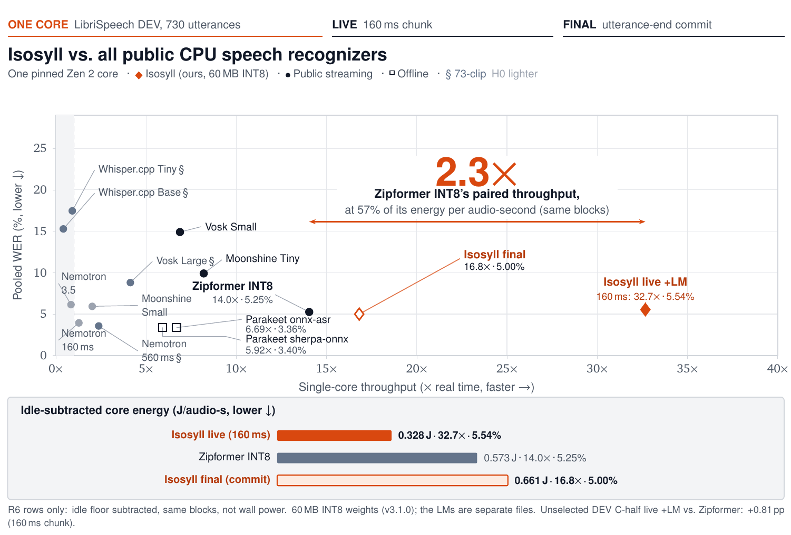

# Isosyll: Always Listening, Barely Computing

**Bit-exact streaming speech recognition on one CPU core.** Jepson Taylor\*, Ricky Ray Butler\*, Jordan Morrow, Alton Alexander, Jordan Hildebrandt, Besterlyne Jirongo · NEVERHUMAN Research · \*Primary authors.

| Read | For |
| :--- | :--- |
| **[Paper (PDF)](paper/paper.pdf)** | Full method, protocol and results (11 pages) |
| **[CEO Brief (PDF)](briefs/isosyll-v4-ceo-brief.pdf)** ([MD](briefs/ceo-brief.md)) | Why always-on speech gets cheap, and how to pilot it |
| **[CTO Brief (PDF)](briefs/isosyll-v4-cto-brief.pdf)** ([MD](briefs/cto-brief.md)) | INT8 engine, bit-exact kernels, benchmark method |



## Build
```bash
cd paper && pdflatex paper && bibtex paper && pdflatex paper && pdflatex paper
cd ../briefs/src && pdflatex ceo-brief && pdflatex cto-brief
```
Every number in the paper and briefs comes from `paper/data/metrics.tex`, which is generated from signed measurement receipts.

## Source of truth
Code, model release, receipts and the data pipeline: [github.com/neverhuman/jsr](https://github.com/neverhuman/jsr). This folder is a snapshot of `docs/paper/` and `docs/briefs/` for publication.
