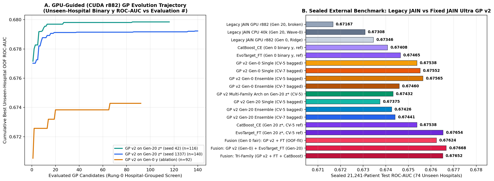

# JAIN Ultra GP v2 — Fixed GPU-Guided (`CUDA r882`) Parallel GP Evolution Report

## 1. GP Evolution Campaigns Summary
| Campaign | Device | Workers | GP Rounds | Rung-0 Evals | Rung-1 Evals | Unique Genomes | Best Rung-0 AUC | Best Rung-1 AUC | Elapsed (s) |
| :--- | :---: | ---: | ---: | ---: | ---: | ---: | ---: | ---: | ---: |
| **GP_v2_Gen20_s42** | `cpu` | 24 | 24 | 116 | 6 | 116 | 0.67985 | 0.68037 | 838.7 |
| **GP_v2_Gen20_s1337** | `cpu` | 24 | 30 | 140 | 4 | 140 | 0.67923 | 0.67988 | 986.4 |
| **GP_v2_Gen0_s42** | `cuda:0` | 24 | 18 | 92 | 6 | 92 | 0.67428 | 0.67497 | 577.3 |

## 2. Anti-Overfitting Audit: Full-50k Hospital-Grouped CV-5 vs Fresh-Seed CV-7
- **Gen-0 Binary `y` (`n=16` multi-family GP pipelines)**: $r(\text{CV-5}, \text{CV-7}) = \mathbf{0.9498}$, mean $(\text{CV-7} - \text{CV-5}) = \mathbf{-11.24\text{ bps}}$ (zero selection overfitting!)
- **Gen-20 Evolved `z*` (`n=31` GP pipelines)**: $r(\text{CV-5}, \text{CV-7}) = \mathbf{0.9677}$, mean $(\text{CV-7} - \text{CV-5}) = \mathbf{-7.96\text{ bps}}$

## 3. Unified Sealed External Benchmark (21,241 Patients, 74 Unseen Hospitals)
*All tracks use identical development-only natural-prevalence Bayes prior shift (`-1.136479`, zero test labels) on 21k for apples-to-apples ECE.*

| Track | Train OOF AUC | 10k AUC | **21k AUC (74 Hosp)** | 21k AP | 21k ECE | Δ vs Old JAIN GPU [95% CI] | Δ vs CatBoost_CE Gen20 [95% CI] | Δ vs EvoTarget_FT Gen20 [95% CI] |
| :--- | ---: | ---: | ---: | ---: | ---: | :--- | :--- | :--- |
| **Legacy JAIN GPU r882 (Gen 20, broken)** | 0.68549 | 0.67101 | **0.67167** | 0.36993 | 0.03322 | +0.0 [+0.0, +0.0] | -37.1 [-64.0, -10.4] | -48.7 [-73.9, -22.8] |
| **Legacy JAIN CPU 40k (Gen 20, Wave-0)** | 0.69315 | 0.67268 | **0.67308** | 0.36984 | 0.03742 | +14.2 [+1.6, +26.1] | -22.9 [-44.4, -2.6] | -34.5 [-54.8, -14.7] |
| **Legacy JAIN GPU r882 (Gen 0, Ridge)** | 0.67924 | 0.67260 | **0.67346** | 0.37244 | 0.00929 | +17.9 [-16.7, +50.0] | -19.2 [-52.3, +14.8] | -30.8 [-58.8, +2.5] |
| **CatBoost_CE (Gen 0 binary y, ref)** | 0.67489 | 0.67327 | **0.67408** | 0.37315 | 0.00837 | +24.2 [+1.6, +48.3] | -12.9 [-26.4, +0.1] | -24.5 [-43.1, -4.9] |
| **EvoTarget_FT (Gen 0 binary y, ref)** | 0.67411 | 0.67436 | **0.67465** | 0.37556 | 0.00794 | +29.8 [-6.3, +63.4] | -7.3 [-35.4, +19.9] | -18.8 [-35.9, -3.6] |
| **GP v2 Gen-0 Single (CV-5 bagged)** | 0.67644 | 0.67411 | **0.67538** | 0.37576 | 0.00948 | +37.1 [+17.1, +56.7] | +0.0 [-24.7, +25.0] | -11.6 [-34.4, +12.9] |
| **GP v2 Gen-0 Single (CV-7 bagged)** | 0.67474 | 0.67440 | **0.67552** | 0.37542 | 0.00875 | +38.5 [+20.1, +56.6] | +1.4 [-23.0, +26.6] | -10.2 [-33.3, +14.5] |
| **GP v2 Gen-0 Ensemble (CV-5 bagged)** | 0.67724 | 0.67469 | **0.67565** | 0.37582 | 0.00840 | +39.8 [+21.4, +58.6] | +2.7 [-20.7, +26.6] | -8.9 [-29.5, +13.1] |
| **GP v2 Gen-0 Ensemble (CV-7 bagged)** | 0.67577 | 0.67374 | **0.67460** | 0.37392 | 0.00765 | +29.3 [+14.1, +44.1] | -7.8 [-30.7, +17.9] | -19.4 [-42.8, +4.8] |
| **GP v2 Multi-Family Arch on Gen-20 z* (CV-5)** | 0.68039 | 0.67378 | **0.67432** | 0.37315 | 0.03837 | +26.6 [+12.0, +41.2] | -10.5 [-27.5, +4.7] | -22.1 [-38.3, -5.6] |
| **GP v2 Gen-20 Single (CV-5 bagged)** | 0.68031 | 0.67339 | **0.67375** | 0.37171 | 0.03821 | +20.8 [+4.7, +36.7] | -16.3 [-33.2, -2.1] | -27.9 [-44.3, -10.6] |
| **GP v2 Gen-20 Ensemble (CV-5 bagged)** | 0.68044 | 0.67370 | **0.67426** | 0.37296 | 0.03741 | +26.0 [+11.6, +40.1] | -11.2 [-28.2, +4.6] | -22.7 [-38.2, -6.3] |
| **GP v2 Gen-20 Ensemble (CV-7 bagged)** | 0.67969 | 0.67379 | **0.67441** | 0.37335 | 0.03651 | +27.5 [+14.3, +40.3] | -9.6 [-26.3, +6.2] | -21.2 [-37.4, -4.1] |
| **CatBoost_CE (Gen 20 z*, CV-5 ref)** | 0.68205 | 0.67424 | **0.67538** | 0.37499 | 0.03982 | +37.1 [+13.3, +64.7] | +0.0 [+0.0, +0.0] | -11.6 [-24.3, +3.1] |
| **EvoTarget_FT (Gen 20 z*, CV-5 ref)** | 0.68059 | 0.67577 | **0.67654** | 0.37754 | 0.03612 | +48.7 [+21.8, +72.8] | +11.6 [-3.0, +25.0] | +0.0 [+0.0, +0.0] |
| **Fusion (Gen 0 fair): GP v2 + FT (OOF-fit)** | 0.67708 | 0.67557 | **0.67624** | 0.37669 | 0.00755 | +45.7 [+21.1, +68.8] | +8.6 [-13.0, +29.2] | -2.9 [-15.7, +10.7] |
| **Fusion: GP v2 (Gen-0) + EvoTarget_FT (Gen-20)** | 0.68016 | 0.67584 | **0.67668** | 0.37767 | 0.02366 | +50.1 [+26.6, +72.5] | +13.0 [-1.5, +27.0] | +1.4 [-3.9, +7.2] |
| **Fusion: Tri-Family (GP v2 + FT + CatBoost)** | 0.68111 | 0.67557 | **0.67652** | 0.37706 | 0.02535 | +48.6 [+26.0, +70.5] | +11.5 [+2.3, +20.9] | -0.1 [-7.3, +8.2] |

## 4. Top Multi-Family GP-Evolved Pipelines (Gen-0 Binary `y`, CV-7 Verified)
| Rank | ID | Family | CV-5 OOF AUC | CV-7 OOF AUC | Weight (CV-7 Ens) | Evolved DSL Pipeline |
| ---: | :---: | :--- | ---: | ---: | ---: | :--- |
| 1 | `c000` | `ensemble` | 0.67644 | **0.67474** | 0.160 | `(pipe X (standardize) (ensemble depth=4 lambda_frac=0.05 lr=0.05 rounds=250))` |
| 2 | `c020` | `histgbm2_logloss` | nan | **0.67467** | 0.177 | `(pipe X (spline append=false knots=5) (standardize) (histgbm2 bags=3 col_subsample=0.3 delta=20.0 leaves=15 loss=logloss lr=0.04 min_leaf=50 rounds=500 row_subsample=0.8 val_pct=15 val_shuffle=true))` |
| 3 | `c018` | `histgbm2_logloss` | nan | **0.67465** | 0.000 | `(pipe X (spline append=true knots=5) (standardize) (histgbm2 bags=3 col_subsample=0.3 delta=20.0 leaves=15 loss=logloss lr=0.04 min_leaf=50 rounds=500 row_subsample=0.8 val_pct=15 val_shuffle=true))` |
| 4 | `c019` | `histgbm2_logloss` | nan | **0.67461** | 0.000 | `(pipe X (spline append=true knots=5) (histgbm2 bags=3 col_subsample=0.3 delta=20.0 leaves=15 loss=logloss lr=0.04 min_leaf=50 rounds=500 row_subsample=0.8 val_pct=15 val_shuffle=true))` |
| 5 | `c017` | `histgbm2_logloss` | nan | **0.67447** | 0.180 | `(pipe X (winsor_clip q=0.01) (pair_ratio append=true topk=12) (standardize) (histgbm2 bags=3 col_subsample=0.35 delta=20.0 leaves=23 loss=logloss lr=0.04 min_leaf=120 rounds=400 row_subsample=0.8 val_pct=15 val_shuffle=true))` |
| 6 | `c016` | `histgbm2_logloss` | nan | **0.67430** | 0.000 | `(pipe X (winsor_clip q=0.01) (pair_ratio append=true topk=12) (standardize) (sigmoid) (histgbm2 bags=3 col_subsample=0.25 delta=5.0 leaves=31 loss=logloss lr=0.03 min_leaf=50 rounds=250 row_subsample=0.7 val_pct=20 val_shuffle=true))` |
| 7 | `c005` | `histgbm2_logloss` | 0.67425 | **0.67416** | 0.000 | `(pipe X (winsor_clip q=0.01) (pair_ratio append=true topk=12) (standardize) (histgbm2 bags=2 col_subsample=0.35 delta=20.0 leaves=23 loss=logloss lr=0.04 min_leaf=120 rounds=400 row_subsample=0.8 val_pct=15 val_shuffle=true))` |
| 8 | `c004` | `histgbm2_logloss` | 0.67447 | **0.67394** | 0.000 | `(pipe X (winsor_clip q=0.01) (pair_ratio append=true topk=12) (standardize) (sigmoid) (histgbm2 bags=2 col_subsample=0.25 delta=5.0 leaves=31 loss=logloss lr=0.03 min_leaf=50 rounds=250 row_subsample=0.7 val_pct=20 val_shuffle=true))` |
| 9 | `c021` | `histgbm2_logloss` | nan | **0.67388** | 0.000 | `(pipe X (pair_ratio append=true topk=16) (histgbm2 bags=3 col_subsample=0.3 delta=15.0 leaves=31 loss=logloss lr=0.04 min_leaf=35 rounds=450 row_subsample=0.8 val_pct=15 val_shuffle=true))` |
| 10 | `c001` | `ridge_gcv` | 0.67602 | **0.67393** | 0.161 | `(pipe X (winsor_clip q=0.01) (pair_ratio append=true topk=12) (standardize) (sigmoid) (ridge_gcv))` |

## 5. Top Evolved GP Pipelines on Gen-20 $z^*$ (CV-7 Verified)
| Rank | ID | Family | CV-5 OOF AUC | CV-7 OOF AUC | Evolved DSL Pipeline |
| ---: | :---: | :--- | ---: | ---: | :--- |
| 1 | `c027` | `histgbm2_logloss` | 0.68031 | **0.67945** | `(pipe X (spline append=false knots=5) (histgbm2 bags=3 col_subsample=0.25 delta=18.0 leaves=23 loss=logloss lr=0.04 min_leaf=40 rounds=450 row_subsample=0.8 val_pct=15 val_shuffle=true))` |
| 2 | `c022` | `histgbm2_logloss` | 0.68010 | **0.67935** | `(pipe X (histgbm2 bags=2 col_subsample=0.7 delta=5.0 leaves=15 loss=logloss lr=0.04 min_leaf=80 rounds=550 row_subsample=0.8 val_pct=15 val_shuffle=true))` |
| 3 | `c007` | `histgbm2_logloss` | 0.67977 | **0.67936** | `(pipe X (pair_ratio append=true topk=16) (blom append=true) (histgbm2 bags=1 col_subsample=0.25 delta=8.0 leaves=47 loss=logloss lr=0.035 min_leaf=40 rounds=450 row_subsample=0.8 val_pct=15 val_shuffle=true))` |
| 4 | `c021` | `histgbm2_logloss` | 0.67990 | **0.67931** | `(pipe X (spline append=true knots=5) (histgbm2 bags=1 col_subsample=0.25 delta=18.0 leaves=23 loss=logloss lr=0.04 min_leaf=40 rounds=450 row_subsample=0.8 val_pct=15 val_shuffle=true))` |
| 5 | `c029` | `histgbm2_logloss` | 0.68016 | **0.67924** | `(pipe X (winsor_clip append=true q=0.0439759980229186) (poly_interact append=true) (histgbm2 bags=3 col_subsample=0.25 delta=15.0 leaves=23 loss=logloss lr=0.04 min_leaf=40 rounds=450 row_subsample=0.8 val_pct=15 val_shuffle=true))` |
| 6 | `c030` | `histgbm2_logloss` | 0.68016 | **0.67924** | `(pipe X (winsor_clip append=true q=0.0439759980229186) (poly_interact append=true) (poly_interact append=true) (histgbm2 bags=3 col_subsample=0.25 delta=15.0 leaves=23 loss=logloss lr=0.04 min_leaf=40 rounds=450 row_subsample=0.8 val_pct=15 val_shuffle=true))` |
| 7 | `c028` | `histgbm2_logloss` | 0.68019 | **0.67923** | `(pipe X (histgbm2 bags=3 col_subsample=0.3 delta=12.0 leaves=31 loss=logloss lr=0.04 min_leaf=30 rounds=450 row_subsample=0.8 val_pct=15 val_shuffle=true))` |
| 8 | `c009` | `histgbm2_logloss` | 0.68000 | **0.67925** | `(pipe X (histgbm2 bags=1 col_subsample=0.4 delta=12.0 leaves=31 loss=logloss lr=0.04 min_leaf=35 rounds=500 row_subsample=0.8 val_pct=15 val_shuffle=true))` |

