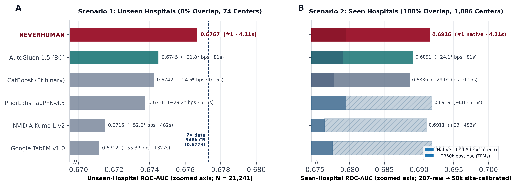

# Pre-Incision POAF Prediction Across Unseen and Seen U.S. Hospitals

National, leakage-audited benchmark of **368,132 isolated-CABG procedures across 1,091 U.S. surgical centers** (STS Adult Cardiac Surgery Database v2.81; `367,695` labeled procedures; `89,337` POAF events, `24.30%`; strictly `207` pre-incision predictors) comparing five leading binary tabular AI platforms—**Google TabFM v1.0.0**, **NVIDIA KumoTabular-Large v2**, **PriorLabs TabPFN-3.5**, **CatBoost**, and **AutoGluon 1.5 (`best_quality`)**—directly against **NEVERHUMAN** across two matched deployment regimes (`N = 21,241` natural-prior holdouts):

1. **Scenario 1 — Unseen Hospitals (`74` unseen centers, `0.0%` hospital overlap)**
2. **Scenario 2 — Seen Hospitals (all `1,091` centers in training, `1,086` test centers, `100.0%` overlap)**



---

## Submission-Ready Publications & Executive Briefs

| Artifact | Direct PDF | Source & Build | Summary |
| :--- | :--- | :--- | :--- |
| ***NEJM AI* Original Article** (13 pp) | **[docs/nejm_ai/main.pdf](docs/nejm_ai/main.pdf)** | [main.tex](docs/nejm_ai/main.tex) · [Makefile](docs/nejm_ai/Makefile) · [Figures](docs/nejm_ai/figures/) | 246-word structured abstract, IMRaD, 5 main tables, 5 figures, TRIPOD+AI Supplement |
| ***npj Digital Medicine* Research Article** (12 pp) | **[docs/npj_digital_medicine/main.pdf](docs/npj_digital_medicine/main.pdf)** | [main.tex](docs/npj_digital_medicine/main.tex) · [Makefile](docs/npj_digital_medicine/Makefile) · [Figures](docs/npj_digital_medicine/figures/) | 12-word title, 147-word unstructured abstract, IRDM, 51 `naturemag` refs, Nature Portfolio SI |
| **CEO Executive Brief** (2 pp) | **[docs/briefs/neverhuman-poaf-ceo-brief.pdf](docs/briefs/neverhuman-poaf-ceo-brief.pdf)** | [ceo-brief.md](docs/briefs/ceo-brief.md) · [LaTeX](docs/briefs/src/ceo-brief.tex) | Boardroom scorecard, FPR & U.S./Global clinical impact, 3-step pilot roadmap |
| **CTO Technical & Latency Brief** (2 pp) | **[docs/briefs/neverhuman-poaf-cto-brief.pdf](docs/briefs/neverhuman-poaf-cto-brief.pdf)** | [cto-brief.md](docs/briefs/cto-brief.md) · [LaTeX](docs/briefs/src/cto-brief.tex) | Full train/infer latency & VRAM matrix, split architecture, reproducible audit CLI |
| **Verified Aggregate Benchmark Receipt** | **[reports/clean_publication_receipt.md](reports/clean_publication_receipt.md)** | [clean_publication_receipt.json](reports/clean_publication_receipt.json) | 5,000-draw hospital-cluster CIs, measured timing, FPR & population scaling (zero patient data) |

---

## Key Figures (600-DPI PNG & Vector PDF)

- **Figure 1 — Page 1 Hero Benchmark (Unseen vs. Seen Hospitals):** [NEJM AI PNG](docs/nejm_ai/figures/fig1_hero_benchmark_and_speed.png) · [npj PNG](docs/npj_digital_medicine/figures/fig1_hero_benchmark_and_speed.png)
- **Figure 2 — STS Hospital Dispersion & Split Leakage Audit:** [NEJM AI PNG](docs/nejm_ai/figures/fig2_cohort_audit_and_split_regimes.png) · [npj PNG](docs/npj_digital_medicine/figures/fig2_cohort_audit_and_split_regimes.png)
- **Figure 3 — Cold-Start to In-Network Calibration Progression:** [NEJM AI PNG](docs/nejm_ai/figures/fig3_unseen_vs_seen_hospitals.png) · [npj PNG](docs/npj_digital_medicine/figures/fig3_unseen_vs_seen_hospitals.png)
- **Figure 4 — Train Time, Per-Patient Latency & Speed Pareto:** [NEJM AI PNG](docs/nejm_ai/figures/fig4_train_and_inference_efficiency.png) · [npj PNG](docs/npj_digital_medicine/figures/fig4_train_and_inference_efficiency.png)
- **Figure 5 — Calibration, Decision Curve Analysis & FPR / U.S.–Global Impact:** [NEJM AI PNG](docs/nejm_ai/figures/fig5_clinical_utility_calibration_equity.png) · [npj PNG](docs/npj_digital_medicine/figures/fig5_clinical_utility_calibration_equity.png)

---

## Reproducible Build & Compliance Verification

```bash
# 1. Deterministically rebuild BOTH submission-ready clinical journal PDFs
make -C docs/nejm_ai -B && make -C docs/npj_digital_medicine -B

# 2. Rebuild and verify BOTH 2-page CEO & CTO executive briefs
bash docs/briefs/scripts/build_briefs.sh
bash docs/briefs/scripts/build_briefs.sh --check

# 3. Run automated compliance, privacy, and link verification
python3 scripts/41_audit_ip_clean_publication.py \
  --nejm-dir docs/nejm_ai \
  --npj-dir docs/npj_digital_medicine \
  --scan-dirs docs reports README.md \
  --md-links README.md docs/briefs/ceo-brief.md docs/briefs/cto-brief.md
```

*Data Governance Note:* All patient-level STS ACSD v2.81 records remain strictly quarantined under STS Participant User File data-use agreements. This repository contains only aggregate evaluation receipts, LaTeX manuscript sources, compiled PDFs, vector figures, and compliance scripts.
