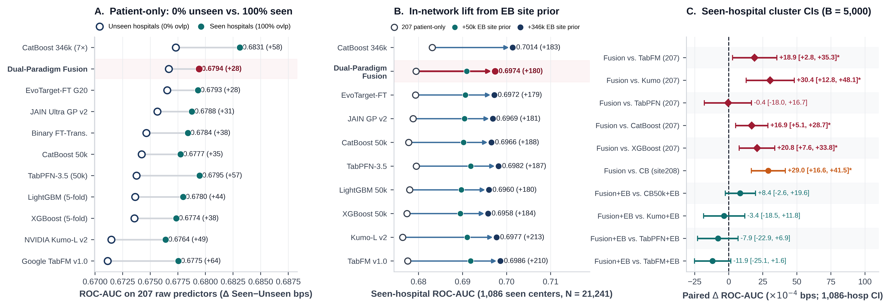

# japer

Jepson keeps papers here and works with collaborators.

## Pre-Incision POAF Prediction Across 1,091 U.S. Hospitals (*NEJM AI* & *npj Digital Medicine* Editions)

National, leakage-audited evaluation of **368,132 isolated-CABG procedures across 1,091 U.S. surgical centers** (STS ACSD v2.81; 367,695 labeled cases; 89,337 POAF events, `24.30%`; strictly `207` pre-incision predictors) comparing six bedside clinical risk scores, six binary tabular learning families (`CatBoost`, `LightGBM`, `XGBoost`, `TabPFN-3.5`, `KumoTabular-Large v2`, `TabFM v1.0.0`), 1,000-generation continuous-target learning (`EvoTarget-FT`), re-engineered GPU-guided parallel genetic programming (`JAIN Ultra GP v2`), and `Dual-Paradigm Fusion` across two matched regimes: **Cold-Start Unseen Hospitals (74 centers, 0% overlap)** and **In-Network Seen Hospitals (all 1,091 centers in training, 100% overlap)**.

| Publication Edition / Artifact | Direct PDF | Source & Figures | Highlights |
| :--- | :--- | :--- | :--- |
| ***NEJM AI* Original Article** (16 pp) | **[NEJM AI Manuscript (PDF)](POATFIB/EvoTarget/docs/nejm_ai/main.pdf)** | [LaTeX](POATFIB/EvoTarget/docs/nejm_ai/main.tex) · [Makefile](POATFIB/EvoTarget/docs/nejm_ai/Makefile) · [Figures 1–7](POATFIB/EvoTarget/docs/nejm_ai/figures/) | 248-word structured abstract, IMRaD, Takeaways Box, Literature Reconciliation Table (0.61–0.93 AUCs), TRIPOD+AI Supplement |
| ***npj Digital Medicine* Research Article** (15 pp) | **[npj Digital Medicine Manuscript (PDF)](POATFIB/EvoTarget/docs/npj_digital_medicine/main.pdf)** | [LaTeX](POATFIB/EvoTarget/docs/npj_digital_medicine/main.tex) · [Makefile](POATFIB/EvoTarget/docs/npj_digital_medicine/Makefile) · [Figures 1–7](POATFIB/EvoTarget/docs/npj_digital_medicine/figures/) | 12-word title, 149-word unstructured abstract, IRDM, $\le 60$ `naturemag` refs, Literature Reconciliation Table, Nature Portfolio SI |
| **Technical Benchmark Paper v4** (17 pp) | **[Technical Paper v4 (PDF)](POATFIB/EvoTarget/docs/paper/main.pdf)** | [LaTeX](POATFIB/EvoTarget/docs/paper/main.tex) · [Red-Team Review](POATFIB/EvoTarget/docs/paper/RED_TEAM_REVIEW.md) | Deep ablation ledger, 1,000-gen & nested 2×2 causal audit |
| **Executive & Technical Briefs** (2 pp each) | **[CEO Brief (PDF)](POATFIB/EvoTarget/docs/briefs/evotarget-poaf-ceo-brief.pdf)** · **[CTO Brief (PDF)](POATFIB/EvoTarget/docs/briefs/evotarget-poaf-cto-brief.pdf)** | [CEO MD](POATFIB/EvoTarget/docs/briefs/ceo-brief.md) · [CTO MD](POATFIB/EvoTarget/docs/briefs/cto-brief.md) | Clinical ROI, governance, architecture & verification CLI |

### Headline Results at a Glance (`N = 21,241` Natural-Prior Holdout)

| Regime | Champion / Comparator | ROC-AUC (Cluster 95% CI) | Key Clinical & Statistical Takeaway |
| :--- | :--- | :--- | :--- |
| **Unseen Hospitals (0% overlap, 74 centers)** | **Dual-Paradigm Fusion (`GP v2 + EvoTarget-FT`)** | **0.6767** (`0.6686–0.6858`) | **`+577 bps`** vs. Mariscalco POAF (`0.6190`), **`+20–55 bps`** vs. all 6 binary AI baselines (all CIs `> 0`), recovers **`79.2%`** of 7× 346k CatBoost gap (`0.6773`), avoids **20.4–33.8 unnecessary interventions / 100 patients** (`P>0 = 1.000`), wins **24/25 subgroups** |
| **Seen Hospitals — Patient-Only (100% overlap, 207 raw)** | **Dual-Paradigm Fusion** / **TabPFN-3.5 (50k)** | **0.6794** / **0.6795** | Hospital overlap alone inflates patient-only AUCs **`+28–64 bps`** (`+49–64 bps` for TFMs vs. `+28 bps` for Fusion); Fusion beats Kumo (`+30.4*`), XGB (`+20.8*`), TabFM (`+18.9*`), CatBoost (`+16.9*`), and LGBM (`+14.5*`) |
| **Seen Hospitals + Train-Only EB Site Prior** | **Dual-Paradigm Fusion (`site208` / `+EB346k`)** / **346k CatBoost (`site208`)** | **0.6916** / **0.6974** / **0.7014** | Train-only Empirical-Bayes hospital priors lift every 50k model **`+174–213 bps`** (to `0.6958–0.6986`) and push 346k CatBoost past `0.70` to **`0.7014`** (`slope 1.014`, `O:E 0.999`, `1.96×` lift); Fusion leads native 50k `site208` (`+29.0* bps` vs. CatBoost `site208`) |
| **Published Literature Context (PROBAST Appraisals)** | **External Median vs. Higher-AUC Claims (`0.72–0.98`)** | **`0.61` ext. median** | Higher published AUCs reflect post-incision/ICU fields (Magee `0.72`, Cho `0.73–0.89`, Cao `0.81`, Ma `0.93`), mixed valve+CABG (Mathew `0.77`, COM-AF `0.78 → 0.576` unseen), or continuous waveforms/multimodal streams (Han `0.71`, Khalpey `0.89`); our cold-start `0.6767` sits **`+6.7` AUC pts above the external median** |

- **Machine-Verified Aggregate Receipts:**
  - [Clinical, Calibration, DCA & 25-Subgroup Equity Receipt (MD)](POATFIB/EvoTarget/reports/clinical_journal_analyses.md) · [JSON](POATFIB/EvoTarget/reports/clinical_journal_analyses.json)
  - [Seen-Hospital (All 1,091 Centers in Train) Master Receipt (MD)](POATFIB/EvoTarget/reports/seen_hospital_study/seen_hospital_master_receipt.md) · [JSON](POATFIB/EvoTarget/reports/seen_hospital_study/seen_hospital_master_receipt.json)
  - [Unseen-Hospital v4 Master Benchmark Receipt (MD)](POATFIB/EvoTarget/reports/paper_v4_master_receipt.md) · [JSON](POATFIB/EvoTarget/reports/paper_v4_master_receipt.json)
- **Publication Figures (600-DPI PNG / Vector PDF):**
  - [Fig. 1 Study Design & Split Audit](POATFIB/EvoTarget/docs/nejm_ai/figures/fig1_study_design_and_split_audit.png) · [Fig. 2 Primary Benchmark](POATFIB/EvoTarget/docs/nejm_ai/figures/fig2_primary_benchmark_and_forest.png) · [Fig. 3 1,000-Gen Evolution & 2×2 Proof](POATFIB/EvoTarget/docs/nejm_ai/figures/fig3_target_evolution_and_causal_proof.png) · [Fig. 4 JAIN GP v2 & Clinical Drivers](POATFIB/EvoTarget/docs/nejm_ai/figures/fig4_jain_gp_v2_and_interpretability.png) · [Fig. 5 Calibration & DCA](POATFIB/EvoTarget/docs/nejm_ai/figures/fig5_calibration_stratification_dca.png) · [Fig. 6 Subgroup Equity & Site Transport](POATFIB/EvoTarget/docs/nejm_ai/figures/fig6_equity_subgroups_and_hospital_transport.png) · [Fig. 7 Seen vs. Unseen Hospitals](POATFIB/EvoTarget/docs/nejm_ai/figures/fig7_seen_vs_unseen_hospitals.png)
- [Full POAF study & supplement index](POATFIB/EvoTarget/README.md)

---

## Isosyll: Always Listening, Barely Computing

Bit-exact streaming speech recognition on one CPU core. The 11-page paper and both executive briefs are in this repo.

- **[Paper (PDF)](Isosyll/paper/paper.pdf)** · [Hero figure](Isosyll/paper/money.png) · [LaTeX](Isosyll/paper/paper.tex)
- **[CEO brief (PDF)](Isosyll/briefs/isosyll-v4-ceo-brief.pdf)** · [Markdown](Isosyll/briefs/ceo-brief.md)
- **[CTO brief (PDF)](Isosyll/briefs/isosyll-v4-cto-brief.pdf)** · [Markdown](Isosyll/briefs/cto-brief.md)
- [Isosyll folder](Isosyll/README.md)

## Other papers

- [Earlier postoperative atrial fibrillation manuscripts](POATFIB/README.md)
- [NoAccident paper](noaccident/paper/)
