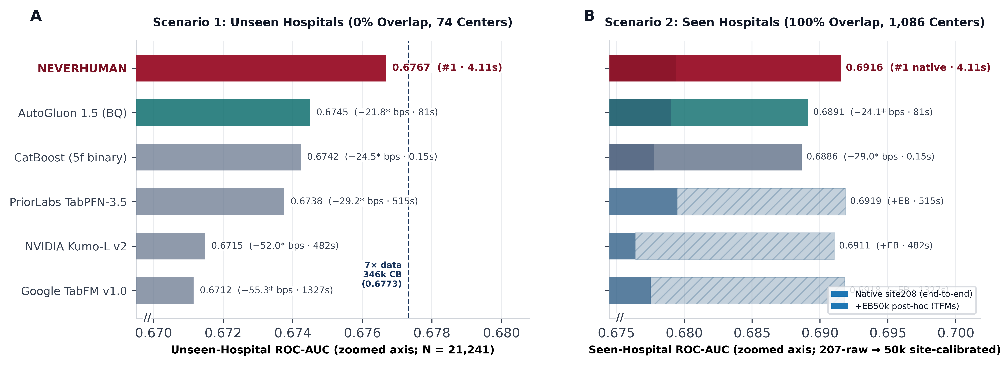

# japer

Jepson keeps papers here and works with collaborators.

## Pre-Incision POAF Prediction Across Unseen & Seen U.S. Hospitals (*NEJM AI* & *npj Digital Medicine* Editions)

National, leakage-audited evaluation of **368,132 isolated-CABG procedures across 1,091 U.S. surgical centers** (STS ACSD v2.81; `367,695` labeled cases; `89,337` POAF events, `24.30%`; strictly `207` pre-incision predictors) benchmarking five leading binary tabular AI models—**Google TabFM v1.0.0**, **NVIDIA KumoTabular-Large v2**, **PriorLabs TabPFN-3.5**, **CatBoost**, and **AutoGluon 1.5 (`best_quality`)**—directly against **NEVERHUMAN** across two matched deployment regimes (`N = 21,241` natural-prior holdouts): **Scenario 1 — Unseen Hospitals** (`74` unseen centers, `0.0%` overlap) and **Scenario 2 — Seen Hospitals** (all `1,091` centers in training, `1,086` test centers, `100.0%` overlap).

| Publication Edition / Artifact | Direct PDF | Source & Figures | Highlights |
| :--- | :--- | :--- | :--- |
| ***NEJM AI* Original Article** (13 pp) | **[NEJM AI Manuscript (PDF)](POATFIB/PreIncision_POAF/docs/nejm_ai/main.pdf)** | [LaTeX](POATFIB/PreIncision_POAF/docs/nejm_ai/main.tex) · [Makefile](POATFIB/PreIncision_POAF/docs/nejm_ai/Makefile) · [Figures 1–5](POATFIB/PreIncision_POAF/docs/nejm_ai/figures/) | 246-word structured abstract, IMRaD, Speed & FPR/U.S.–Global Impact Tables, Literature Reconciliation (0.61–0.93 AUCs), TRIPOD+AI Supplement |
| ***npj Digital Medicine* Research Article** (12 pp) | **[npj Digital Medicine Manuscript (PDF)](POATFIB/PreIncision_POAF/docs/npj_digital_medicine/main.pdf)** | [LaTeX](POATFIB/PreIncision_POAF/docs/npj_digital_medicine/main.tex) · [Makefile](POATFIB/PreIncision_POAF/docs/npj_digital_medicine/Makefile) · [Figures 1–5](POATFIB/PreIncision_POAF/docs/npj_digital_medicine/figures/) | 12-word title, 147-word unstructured abstract, IRDM, 51 `naturemag` refs, FPR & Population Scaling, Nature Portfolio SI |
| **Executive & Technical Briefs** (2 pp each) | **[CEO Brief (PDF)](POATFIB/PreIncision_POAF/docs/briefs/neverhuman-poaf-ceo-brief.pdf)** · **[CTO Brief (PDF)](POATFIB/PreIncision_POAF/docs/briefs/neverhuman-poaf-cto-brief.pdf)** | [CEO MD](POATFIB/PreIncision_POAF/docs/briefs/ceo-brief.md) · [CTO MD](POATFIB/PreIncision_POAF/docs/briefs/cto-brief.md) | Boardroom scorecard, latency/VRAM matrix, U.S./Global clinical impact & verification CLI |

### Head-to-Head Scorecard: Accuracy, Speed, FPR & U.S./Global Impact (`N = 21,241`)

| Model (50k Parity Unless Noted) | Unseen AUC (74 hosp) | NEVERHUMAN $\Delta$ Unseen (95% CI) | Seen Native 208 | Seen +EB346k | Train / Prep | 21k Batch Infer | FPR @ 70% Sens (Unseen) |
| :--- | ---: | :--- | ---: | ---: | ---: | ---: | ---: |
| **NEVERHUMAN (Proprietary)** | **0.6767** | **#1 @ 50k (0.0072 ECE)** | **0.6916** | **0.6974** | **21.5 min** | **4.11 s (0.193 ms/pt)** | **44.10% (Lowest)** |
| AutoGluon 1.5 (`best_quality`) | 0.6745 | **+21.8 [+7.0, +36.5]\*** | 0.6891 | 0.6974 | 30.0 min | 80.99 s (`19.7×` slower) | 44.42% (`+490` U.S. / `+2,448` gl.) |
| CatBoost (5-fold binary) | 0.6742 | **+24.5 [+7.2, +42.2]\*** | 0.6886 | 0.6966 | 0.8 min | 0.15 s | 44.58% (`+734` U.S. / `+3,672` gl.) |
| PriorLabs TabPFN-3.5 (50k native) | 0.6738 | **+29.2 [+8.2, +53.5]\*** | --- | 0.6982 | 0.9 s | 515.3 s (`125×` slower) | 44.76% (`+1,007` U.S. / `+5,037` gl.) |
| NVIDIA KumoTabular-Large v2 | 0.6715 | **+52.0 [+21.6, +83.3]\*** | --- | 0.6977 | 3.3 min | 481.7 s (`117×` slower) | 45.28% (`+1,798` U.S. / `+8,992` gl.) |
| Google TabFM v1.0.0 | 0.6712 | **+55.3 [+28.6, +81.5]\*** | --- | 0.6986 | 6.6 min | 1,326.7 s (`323×` slower) | 45.14% (`+1,582` U.S. / `+7,909` gl.) |
| *Mariscalco POAF Bedside Proxy* | *0.6190* | ***+577.0 [+495.6, +656.9]\**** | *---* | *---* | *---* | *< 0.01 s* | *76.30% (`+48,755` U.S. / `+243,774` gl.)* |
| *7× Full-Registry CatBoost (346k)* | *0.6773* | *−6.4 (NH beats on AP & ECE)* | ***0.7014*** | *---* | *6.2 min* | *0.30 s* | *---* |

- **Population-Scaled Clinical Impact (200,000 Annual U.S. CABG / 1,000,000 Global Cardiac Surgeries):**
  - Across `367,695` STS cases, POAF carried nearly double the operative mortality (`2.78%` vs. `1.42%`, `+1.36 pp`, `1.96×`), `2.00×` prolonged ventilation, and `3.05×` renal failure.
  - At 70% POAF capture, NEVERHUMAN's **`44.10%` FPR** (`41.22%` on seen `site208`) spares **`490–1,798` U.S. patients/yr** (`2,448–8,992` globally) from unnecessary prophylaxis vs. the five binary AI alternatives and **`48,755` U.S. patients/yr** (`243,774` globally) vs. Mariscalco POAF.
  - Under Top-25% PALACS prophylaxis (`45%` RRR), NEVERHUMAN models **`8,758` U.S. / `43,790` global** POAF episodes prevented/yr, **`$87.6M–$131.4M/yr`** in U.S. hospital cost avoidance, and (at conservative `25%–50%` causal mortality attribution; `100%` upper bound) **`30–60` (upper `119`) U.S. / `149–298` (upper `596`) global** operative deaths averted/yr.
- **Literature Context (`0.61–0.93` Published AUCs):** Published AUCs `> 0.72` reflect post-incision/ICU predictors, mixed valve-plus-CABG cohorts, continuous ECG/imaging modalities, or hospital-overlapping splits; PROBAST external appraisals average **`0.61`**, placing NEVERHUMAN's unseen cold-start **`0.6767`** **`+6.7` AUC points** above the published external median.
- **Verified Receipts & Full Suite Index:**
  - [Clean Master Benchmark, Timing & Clinical-Impact Receipt (MD)](POATFIB/PreIncision_POAF/reports/clean_publication_receipt.md) · [JSON](POATFIB/PreIncision_POAF/reports/clean_publication_receipt.json)
  - [Full Study Index, Figures 1–5 & Reproducible Audit CLI](POATFIB/PreIncision_POAF/README.md)

---

## Isosyll: Always Listening, Barely Computing

Bit-exact streaming speech recognition on one CPU core. The 11-page paper and both executive briefs are in this repo.

- **[Paper (PDF)](Isosyll/paper/paper.pdf)** · [Hero figure](Isosyll/paper/money.png) · [LaTeX](Isosyll/paper/paper.tex)
- **[CEO brief (PDF)](Isosyll/briefs/isosyll-v4-ceo-brief.pdf)** · [Markdown](Isosyll/briefs/ceo-brief.md)
- **[CTO brief (PDF)](Isosyll/briefs/isosyll-v4-cto-brief.pdf)** · [Markdown](Isosyll/briefs/cto-brief.md)
- [Isosyll folder](Isosyll/README.md)

## Other papers

- [Earlier postoperative atrial fibrillation manuscripts](POATFIB/README.md)
- [NoAccident paper](noaccident/paper/)
